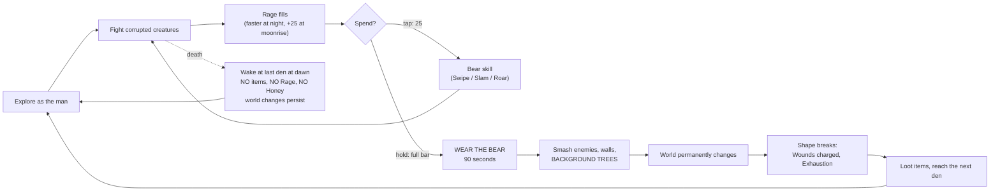
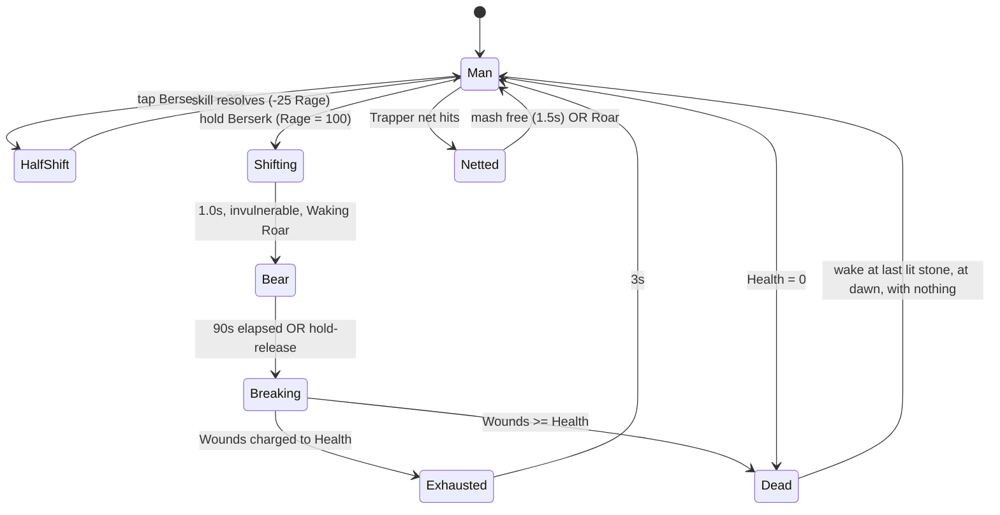

# WEAR THE BEAR — a Werebear Action-RPG Platformer

> **Status:** design spec **v1.0, locked for the first level.** A playable browser implementation is built and locally verified; production deployment is pending.
> **Title:** ***Wear the Bear*** (chosen by the user 2026-10-09). Old Norse **berserkr** means "bear-shirt": you start shirtless, and the Rage bar is the shirt you earn. Holding Berserk with a full bar is literally "wearing the bear".
> **Scope:** **one level**, *The Elderwold*. Wake alone in the forest, scavenge, reach the Den (first checkpoint), then press deeper.
> **Hosting:** the game at **`werebear.xeb.ai/`**; the current codex moves to **`werebear.xeb.ai/research/`** (§17).

---

## 0. Decision Log

| # | Topic | Decision | Source |
|---|-------|----------|--------|
| D1 | **Death** | Respawn at the last checkpoint with **no weapons and no resources**: loincloth only, 0 Rage, 0 Honey. **No currency exists in the game.** | User |
| D2 | **Cycle** | **Day (sun) / Night (moon) cycle.** The illustrated art changes between them. The bear can be called **at will whenever Rage is charged**; the cycle changes rates, threats and the look, but never locks the bear. | User |
| D3 | **Rage spending** | **Tap** the Berserk button: a single bear skill that **burns part of the bar** (one 25-point segment). **Hold** with a full bar: **full transformation lasting 90 seconds.** | User |
| D4 | **Art** | **Fully illustrated**, readysetsanta-style painted sprites and backgrounds, at a **smaller character scale** suited to an action RPG. | User |
| D5 | **Scope** | **One level**: alone in the forest → find resources → **Den = first checkpoint** → press deeper into the forest. | User |
| D6 | **Hosting** | Game at `werebear.xeb.ai/`; codex at `werebear.xeb.ai/research/`. | User |
| D7 | Persistence across deaths | **The world remembers; you don't.** Felled trees, broken walls, opened shortcuts, unlocked checkpoints and the defeated boss persist. Inventory does not. | Derived from D1 |
| D8 | Stamina | Light stamina bar (dodge, heavy, sprint). | Default, unanswered |
| D9 | Parry | In the game, unlocked by Bark Bracers. | Default, unanswered |
| D10 | Difficulty | Fair-hard, with an **Assist** toggle (Wounds can't kill; +1 starting Honey after each respawn). | Default, unanswered |
| D11 | Orientation | **Landscape**, with a rotate prompt in portrait. | Default, unanswered |
| D12 | Music | Synthesised, adaptive layers (Web Audio). No licensed tracks. | Default, unanswered |
| D13 | Gamepad | Supported in v1. | Default, unanswered |
| D14 | Level climax | The level ends with a boss, **Old Thorngut**, in the Rotted Clearing. | User |
| D15 | **Title** | ***Wear the Bear.*** Coming-soon tagline: "Wake with nothing. Earn the fury." | User |
| D16 | Cold open | Keep the 30-second playable bear dream before Bjarki wakes. | User |
| D17 | Sleep | Sleeping at a checkpoint restores Health, respawns enemies and skips to the next dawn. | User |

Removed from the v0.1 draft: Amber currency, Marks/stat levelling, the Shed Pelt recovery, the Heartwood Pulse (replaced by the day/night cycle), and the 12s/kill-extended berserk (replaced by a fixed 90s).

---

## 1. Pitch

You wake in a hollow under the roots with a scrap of cloth around your waist and nothing else. The forest is rotting, and corrupted creatures are carrying off the old tools of your people. You take them back one at a time: a sharpened stick, a pouch of river stones, bark bracers.

Every fight feeds the **Rage** inside you. Spend it in small bites (an arm that swells into a bear's paw for one crushing swipe) or save it all. When the bar is full, hold the paw and **wear the bear**. For **ninety seconds** you are a two-and-a-half-metre Primalist Titan. You smash enemies through each other and **knock background trees down across the level**. Those fallen trees become bridges and shortcuts, and they **stay down, even after you die.**

Then the shape breaks, and every blow the bear took comes due.

If you die, you wake at the last den with nothing. The forest remembers what you did to it. You start again with no weapons, but the trees you felled are still lying where they fell.

---

## 2. Design Pillars

| # | Pillar | In practice |
|---|--------|-------------|
| 1 | **Fragile man, unstoppable bear** | The man is careful and precise. The bear is a 90-second storm. The contrast is the game. |
| 2 | **Fight to earn the fury** | Rage comes from fighting well. Night speeds it up. Nothing hands you the bear for free. |
| 3 | **Spend or save** | Every 25 Rage is a choice: a bear skill now, or one step closer to the 90-second Titan. |
| 4 | **The world remembers the bear** | Felled trees, broken walls and opened shortcuts are permanent. **The world is your progression; the inventory is not.** |
| 5 | **Start with nothing, every time** | Every item is small, physical and visible on the sprite. Death takes them all. Re-arming quickly is a skill. |
| 6 | **Death is a teacher** | Souls-like: readable tells, punishable recoveries, checkpoints. Knowledge is the only thing you keep. |

---

## 3. Lore → Mechanics

| Lore | Mechanic |
|------|----------|
| You are **Bjarki** ("little bear"), the last *hamrammr* (shape-strong) of the Bearkin, waking from the Long Sleep. | Start with nothing. Checkpoints are **dens**. |
| *"The bear does not die. It sleeps, and wakes at dawn."* | Death returns you to the last den **at dawn**, naked and empty-handed. |
| The *berserkr* fought without armour, wrapped in the bear instead. | Body items never protect the bear. The bear uses its own hide (see Wounds). |
| **The rot thrives in darkness and withers in the sun.** | **Day:** rot creatures are slower and weaker; Rage builds slowly. **Night:** the rot is bolder, new night-only creatures appear, and Rage builds fast. |
| **The bear is the moon's child.** At moonrise, the shape stirs. | **Moonrise grants +25 Rage** (one segment). Rage gain ×1.5 at night. |
| The forest gives its dead and rot-taken wood to the bear. | You can **fell trees** in bear form (§9). Rotwood saplings fall to a single bear skill. |
| *"The bear takes the blows. The man pays for them."* | **Wounds** (§7.4). |
| The rot has stolen the Bearkin's tools: knives, wraps, honey. | Items drop from monsters and caches. Respawned creatures carry them again. |
| Hunters drove an iron nail into the Mother Oak. The rot spreads from that wound. | The level points toward the Heartwood. **Iron is cursed**: it empowers the man and binds the shape (§8). |

**Tone:** grim Norse folklore with a cathartic power fantasy. Mud, moss, amber sun and silver moon, not gore.

---

## 4. Core Loop



**Rhythm targets (first-time player)**
- First tap skill available: **about 2–3 minutes** in.
- First full transformation: **about 9–13 minutes** in, usually just after nightfall past the Den.
- Bear uptime: **about 25%** of time spent in combat areas over the level.

---

## 5. The Level — *The Elderwold*

One continuous side-scrolling level, about **45 screens wide** (1 screen = 1280 logical px), with vertical layers (canopy paths, ground, root tunnels). Target completion on a first successful run is **20–30 minutes**, with deaths on top.

### 5.1 Checkpoints

| ID | Name | Where | Notes |
|----|------|-------|-------|
| CP0 | **The Waking Hollow** | Start | Root cradle where Bjarki wakes. You respawn here until the Den is lit. |
| CP1 | **The Den** | about screen 14 | **The first real checkpoint.** A bear-shrine stone at the mouth of a cave. |
| CP2 | **The Deep Stone** | about screen 36 | A mossy standing stone before the Rotted Clearing (the boss). |

**Checkpoint interactions**
- **Touch:** lights the stone and sets it as your respawn point. Time does not pass. Free and instant.
- **Sleep:** Bjarki lies down. Health is fully restored, **time skips to the next dawn**, and **all enemies respawn**. Inventory, Honey and Rage are **kept**, because you didn't die. Sleeping is the choice between safety and keeping the night's Rage bonus.
- **Respawn after death:** at the last lit stone, **at dawn**, full Health, **loincloth only, 0 Rage, 0 Honey**.

### 5.2 Beat Sheet

| Sec | Screens | Name | Time of day* | Beats | Teaches |
|-----|---------|------|--------------|-------|---------|
| **Cold open** | n/a | **The Long Sleep** | Night (dream) | 30s playable dream: you **are** the bear, smashing rot creatures and felling one great tree. You hear a roar, the screen whites out, and you wake. | The goal. What you're working toward. |
| **A** | 1–5 | **The Waking Hollow** | Dawn → Day | Wake naked (CP0). Move, jump, crouch through roots. Shake a tree and a pinecone drops (useless, but the tree reacts). The first **"tree you notice"**: a gap with an Elderwood beside it that you can't cross. **Rot Grubs** fought with fists. A grub nest gives the **Sharpened Stick**. The riverbank cache holds **River Stones**. | Movement, attack, dodge, throw. Items appear on the sprite. |
| **B** | 6–13 | **The Thicket** | Day | **Sporecaps**, then a **Mire Hound** pair. Rage reaches 25, and the paw button glows for the first time: a **Bear Swipe** tutorial on a hound. The **pack leader** drops the **Hide Wrap**. A **Rotwood sapling** blocks the path, and **Bear Slam** fells it (first tree ever felled). The **bee-tree** gives the **Honeycomb Pouch** (+Honey). | Rage, tap skills, honey, first felling. |
| **C** | 14 | **The Den (CP1)** | Late day | A safe cave mouth with firelight, the bear-shrine and a **woodpile with a guaranteed Sharpened Stick** (re-arm point). Paintings on the wall show a man becoming a bear, foreshadowing the full transformation. | Checkpoints, the sleep choice. |
| **D** | 15–24 | **The Deeper Wood** | **Dusk → Night** | The art shifts as night falls. **Moonrise: +25 Rage**, with a moon cut-in. **Gloom Moths** (night only) and a **Husk Stag** (drops the **Bone Knife**). Most players reach a full bar here and get the **first full transformation** in an **Elderwood grove** full of trees to fell. A felled tree bridges the gap back toward the Den: the **first permanent shortcut**. Moonlight shafts open through the gaps. | Full transformation, permanent world change, shortcuts. |
| **E** | 25–35 | **The Trappers' Run** | Night → Dawn | An abandoned hunters' line: iron jaw-traps, a **Hollow Trapper** with nets (a netted man **cannot transform** until he breaks free or uses **Roar**). Drops the **Bark Bracers** (parry). A **Rotwood Brute** that only the bear or bear skills can crack. **Thin branches** over a ravine snap under the bear, so this section must be crossed as the man. The cursed **Iron Nail** sits in a trap chest. The hidden **Antler Crown** is behind an Elderwood only the bear can fell. | Parry, the man-only route, cursed items. |
| **F** | 36 | **The Deep Stone (CP2)** | n/a | Checkpoint. A small woodpile re-arm point (stick + 3 stones). | |
| **G** | 37–45 | **The Rotted Clearing** | Any | A short approach, then the **boss: Old Thorngut** (§10.2). When he dies, the rot recedes, dawn breaks over the clearing, and you get the **level complete** summary. | Everything combined. |

\*The day/night cycle runs on a clock (§6), so time of day per section is **typical**, not guaranteed. Every section is designed to work in both day and night.

### 5.3 Re-arm Design (because death strips everything)

Dying with nothing must never become a grind. Rules:
1. **Every checkpoint has a guaranteed basic weapon** (woodpile stick) and a stone cache within 1 screen.
2. **Key item holders respawn** when you sleep or die, and **always drop their item on their first kill of each life.**
3. **Felled trees and opened shortcuts persist**, so each life gets shorter routes. A felled-tree bridge from the Deeper Wood back to the Den is placed so a fresh respawn can reach the Husk Stag (Bone Knife) quickly.
4. **Item value curve:** an unarmed man can still win every regular fight, just slowly. Items speed you up; they never gate progress. The only gates are **bear-only** obstacles (Elderwood, Brute bark, rot-walls) and **man-only** routes (thin branches, crawl-spaces).

---

## 6. Day / Night Cycle

### 6.1 Timing

| Phase | Duration | Notes |
|-------|----------|-------|
| **Dawn** | 0:30 | Crossfade from night art to day art. Respawns and sleep always start here. |
| **Day** | 5:00 | |
| **Dusk** | 0:30 | Crossfade from day to night. **Moonrise** happens at the end. |
| **Night** | 4:00 | |
| **Total cycle** | **10:00** | |

The clock **runs only during gameplay**. It pauses in menus, cut-ins and checkpoint screens. A small sun/moon dial in the HUD shows where you are in the cycle.

### 6.2 Effects

| | **Day (sun)** | **Night (moon)** |
|---|---------------|------------------|
| Rage gain | ×1.0 | **×1.5** |
| Rot creatures | −15% damage, −10% speed | Normal stats; **Gloom Moths** spawn; rot glows |
| Visibility | Full | Darker edges; moonlight shafts are bright pools; the bear's eyes and the rot glow |
| Moonlight shafts | Inactive | **+1 Rage/s** while standing in them |
| Transition events | **Sunrise:** rot creatures in direct light flinch for 1s | **Moonrise:** **+25 Rage** with a short moon cut-in and a howl-like roar sting |
| Bear form | Always available when charged | Always available when charged (same 90s) |

### 6.3 Illustrated art changes

Fully illustrated means real painted variants, not just a tint:
- **Sky:** separate day and night paintings (sun, clouds, birds / moon, stars, drifting mist), plus painted dusk and dawn gradient plates.
- **Far forest layer:** separate day and night paintings.
- **Mid layers, trees, tiles, characters:** one painting each, colour-graded at runtime with a per-phase LUT-style grade (multiply plus colour overlay) and **emissive overlay sprites** for things that glow at night: rot pustules, bear eyes, moth wings, Den fire.
- **Transitions:** a 30s crossfade between paintings, the grade interpolating, and shadows swinging with the light direction (sun from the upper left, moon from the upper right).

---

## 7. Rage & the Two Forms

### 7.1 The Rage bar

- **100 points in 4 segments of 25.** Shown top-centre as a carved bone bar with four sockets and a heartbeat icon.
- **Completed segments never decay.**
- A **partial segment** decays at 2/s after **8s with no combat**, down to the last completed segment.
- Heartbeat audio fades in from 75 and speeds up toward 100. At 100 a held drone and growl play, and the paw button pulses.

### 7.2 Rage gain (human form, before the day/night multiplier)

| Event | Rage |
|-------|------|
| Light hit lands | +1 |
| Heavy hit lands | +3 |
| Thrown stone hits | +1 |
| **You get hit** (and survive) | +5 |
| Kill: regular / elite | +6 / +15 |
| **Perfect dodge** (last 0.15s before impact) | +6 |
| **Parry** | +8 |
| Moonlight shaft (night only) | +1/s |
| **Moonrise** | +25 (flat, no multiplier) |
| Gained while in bear form | 0 |

*These are starting values. They will be tuned with a seeded bot harness against the §4 rhythm targets.*

### 7.3 Spending Rage: one button, two gestures

| Gesture | Requirement | Result |
|---------|-------------|--------|
| **Tap** (< 250ms) | ≥ 25 Rage | **Bear skill.** Burns **25**. The skill depends on the direction held (below). |
| **Hold** (≥ 450ms) | **100** Rage | **Full transformation.** A charge ring fills around the paw button while held. Releasing early with a full bar does nothing (no accidental spend). |
| Tap with < 25 | n/a | Short "not ready" thud, no effect. |

#### Bear skills (tap: one arm becomes the bear's for a moment)

| Skill | Input | Effect | Also |
|-------|-------|--------|------|
| **Bear Swipe** | Tap (neutral / forward) | Bjarki's arm swells into a huge clawed paw: one wide horizontal arc. **5× heavy-attack damage**, big knockback, **breaks guards and enemy super-armour**, tears nets. | 0.35s startup, 0.4s recovery |
| **Bear Slam** | Tap + Down | Overhead paw slam with a short ground shockwave both ways. Damage and stagger in a radius. **Fells Rotwood saplings** (small trees only). Cracks Brute bark. | Also works in the air as a dive slam |
| **Roar** | Tap + Up | A roar from a half-shifted face. **Staggers** everything within 4 tiles, **frees you from nets and traps**, interrupts enemy wind-ups, and makes weak enemies flee for 2s. | 0.2s startup; the panic button |

Tap skills are **only available in human form.** Each one plays a **0.15s "half-shift" flash** (fur bristling, eyes glowing, a brief arm silhouette swap) so the player feels the bear pushing through.

### 7.4 The Man (human form)

| Input | Move | Notes |
|-------|------|-------|
| Attack | **Strike** 1-2-3 | Fists to begin with. Changes with your weapon. |
| Heavy | **Heavy** (hold to charge) | Breaks guard. 20 stamina. |
| Dodge | **Roll** | 0.25s invulnerability, 25 stamina. A perfect dodge gives a 0.2s slow-mo flash and Rage. |
| Jump | **Jump** | Variable height, 100ms coyote time, 120ms input buffer. |
| Throw | **Throw** | Stones, a ranged poke. |
| Heal | **Eat honey** | 1.2s, can be interrupted, heals 35. |
| Block/parry | Hold Dodge + toward the attack | Only with Bark Bracers. 0.18s parry window. |

| Stat | Value |
|------|-------|
| Health | 80 |
| Stamina | 100, regenerates 40/s after a 0.5s delay |
| Run speed | 210 px/s (logical) |
| Jump height | about 2.2 × body height |

**Man-only spaces:** crawl-spaces, thin branches (they snap under the bear), vines, narrow ledges.

### 7.5 The Bear (full transformation, 90 seconds)

Look: the **Primalist Titan** folio (the AI-generated image in the codex). Hunched bipedal grizzly, charcoal fur, leather harness with bone totems, amber eyes, obsidian claws. **About 2× the man's height.**

**Transform (1.0s, invulnerable):** the man crouches, cloth rips and fur erupts, then the **illustrated Titan cut-in** slams across the screen for 0.5s. The **Waking Roar** knocks back and stuns everything on screen for 1.5s. The camera zooms out 10%.

| Input | Bear move | Effect |
|-------|-----------|--------|
| Attack | **Maul**, 3-hit claw chain | Wide arcs that hit every enemy in reach. Launches small enemies. |
| Heavy | **Rend**, two-paw slam | A ground shockwave that travels 6 tiles each way. **Fells Elderwood** (with repeated hits) and Rotwood (in one). |
| Dodge | **Charge**, shoulder bash | Carries enemies along. **Breaks rot-walls. Fells trees.** |
| Jump, then Attack in the air | **Pounce** | Ground-pound crater. Damage scales with fall height. |
| Throw | **Grab & Hurl** | Grab small or medium enemies and throw them into others, walls or trees. |
| Throw near a felled log | **Uproot** | Swing the log as a club: 3 sweeping hits, then it shatters. |
| Hold Berserk 1s | **Release** | End the bear early. Wounds are charged as normal. |

| Rule | Value |
|------|-------|
| **Duration** | **90s fixed.** The Rage bar becomes a draining timer (100 → 0). Kills don't extend it. |
| Damage | About 7× human DPS. Regular enemies die in 1–2 hits. |
| Super-armour | Never flinches. Only boss grabs interrupt it. |
| Speed | 1.25× run, heavier gravity, 60% jump height |
| Hit-stop | 100ms (the man gets 40ms), heavy camera shake (scaled down in reduced motion) |
| Items | None usable: no honey, no stones. Rage gain paused. |
| HUD warning | The last 10s flash the bar, the heartbeat slows, and the claws flicker back to hands for a frame. |

### 7.6 Wounds — "the man pays"

- In bear form, damage **does not reduce Health.** It fills a **grey Wound bar** over Health at **50%** (the bear's hide halves it).
- **Each kill as the bear heals 10 Wounds** (elite: 25).
- When the shape breaks, **remaining Wounds come off Health.**
- If Wounds ≥ Health, you **die when the shape breaks**, unless Assist mode is on (then you are left at 1 HP).
- When Wounds pass current Health, the Health bar outline turns **red** and a low "debt" tone plays: *keep killing.*
- Over 90 seconds Wounds are a real budget. The bear wants targets, not a long walk.

### 7.7 Exhaustion

**3s** after the shape breaks: 60% move speed, no dodge, no Rage gain, no tap skills. Enemies recognise an exhausted player and press in. Timing the break near the last enemy is part of the skill.

### 7.8 Form state machine



---

## 8. Items — "what you carry, the bear remembers"

**Slots:** Hand (weapon) · Body (wrap) · Charm ×2 · Belt (throwables + honey)
**All items are lost on death.** Visible on the sprite as illustrated overlay layers (§12.3).

| Item | Source in *The Elderwold* | Man | Bear remembers |
|------|---------------------------|-----|----------------|
| **Scrap of cloth** | Start (always) | n/a | n/a |
| **Sharpened Stick** | Grub nest (A) · Den woodpile · Deep Stone woodpile | +reach, 3-hit combo, +40% damage | Maul reach +15% |
| **River Stones** ×5 | Riverbank cache (A) · checkpoint caches (×3) | Throw: 6 damage, interrupts | Grab & Hurl +25% damage |
| **Hide Wrap** | Mire Hound pack leader (B) | +25 max Health | Wounds −10% |
| **Honeycomb Pouch** | Bee-tree (B), felled by Bear Slam | +2 Honey (max 3) | Leaving bear form heals 15 |
| **Bone Knife** | Husk Stag (D) | Fast 4-hit combo, bleed | Claws cause bleed |
| **Bark Bracers** | Hollow Trapper (E) | **Unlocks parry** | Charge reflects projectiles |
| **Antler Crown** *(secret)* | Behind an Elderwood (E), bear only | n/a | **Tap skills cost 20 instead of 25** |
| **Iron Nail** *(cursed)* | Trap chest (E) | +40% damage | **Bear lasts 60s instead of 90** (iron binds the shape) |
| **Tooth Necklace** | Old Thorngut (G) | Kills +3 Rage | Kills heal +5 extra Wounds |

**Honey** is a consumable on the belt. It is found (bee-tree, rare drops), never refilled by checkpoints, and lost on death. That makes Honey a real resource under D1.

**Pickup ceremony (key items):** 0.6s slow-mo, the item rotates above Bjarki, one line of flavour text, and the sprite visibly changes.

---

## 9. Felling the Forest (signature system)

Trees live on an **interactive background layer** drawn behind the play plane and **aligned with it** for collision. The man passes in front of them; his strikes only shake leaves and sometimes drop small things.

### 9.1 Tree types

| Type | Size | Felled by | Drops |
|------|------|-----------|-------|
| **Rotwood sapling** | 2–3 tiles | **Bear Slam** (tap skill) or any bear attack | Nothing; just clears the path |
| **Rotwood** (grey bark, glowing fungus) | 6–8 tiles | Any bear Rend, Charge or thrown enemy (1 hit) | Occasionally honey or stones |
| **Elderwood** (healthy, massive) | 10–14 tiles | Bear only, **3 hits** | Nothing (it is the bridge) |
| **Bee-tree** | 6 tiles | Bear Slam or bear | Honeycomb Pouch (first time) |

### 9.2 Fall sequence

1. **Hit:** sap-spray particles; the trunk shows a crack decal per hit.
2. **Creak** (0.35s): the tree shudders and leans with a rising wooden groan, and birds scatter.
3. **Crack:** a sharp splintering snap.
4. **Fall** (0.8s, ease-in): the tree **rotates about its base out of the background layer into the play plane**, falling away from the hit. Its sprite scale goes from 0.92 to 1.0 during the rotation to sell the depth change.
5. **Impact:** a deep boom and long rumble, heavy shake, leaves and dust. **Anything under the arc takes 60 damage** (enemies; the player gets a 0.5s shadow warning).
6. **Result:** a **solid log collider** in the play plane plus a **stump** sprite in the background. If a canopy was over a gap in the treeline, a **moonlight shaft** opens there.

### 9.3 Uses

| Use | Where it appears |
|-----|------------------|
| **Bridge** over a gap | The "tree you notice" in A, which pays off in D |
| **Permanent shortcut** | D → back to the Den; E → over the ravine (bear-felled from the far side) |
| **Crush weapon** | Elderwood grove (D), boss phase 2 (G) |
| **Club** (Uproot) | Any felled log |
| **Barrier** | Blocks a hound den in D, so you can choose to wall them off |
| **Moonlight** | Every felled canopy tree opens a shaft at night |

### 9.4 Persistence

- Saved per tree ID. **Survives death, sleep and reload.**
- The background visibly **opens up** as you fell more: more sky, more light.
- **Level complete summary** shows trees felled out of the total, as a stat to replay for.

### 9.5 Design rule

Every section has **at least one tree you notice early**, so the man sees the bear's future work. Every Elderwood placement must create a **meaningful change** (bridge, shortcut, secret or crush) and never just decoration.

---

## 10. Enemies — the Rot

The readysetsanta rule applies: ***Read the tell, answer it, punish the recovery.*** Every tell uses **pose + sound + colour**, held long enough to react to on a phone.

### 10.1 Roster

| Enemy | HP | Behaviour | Tell → answer | Night change | Drops |
|-------|----|-----------|---------------|--------------|-------|
| **Rot Grub** | 12 | Crawls, lunges | Coils (0.45s) → dodge, punish | Glows, +lunge range | — |
| **Sporecap** | 20 | Stationary; puffs a poison cloud | Cap swells (0.6s) → step out | Bigger cloud | — |
| **Mire Hound** | 28 | Fast; pairs that flank | Growl and crouch (0.4s) → dodge through | Packs of 3 | Hide Wrap (leader) |
| **Gloom Moth** | 16 | **Night only.** Swoops, spits spore darts | Wing flare (0.5s) → dodge or throw a stone | n/a | — |
| **Husk Stag** | 60 | Long charges; stuns itself on walls | Hoof scrape (0.7s) → sidestep into a wall | Faster charge | Bone Knife |
| **Hollow Trapper** | 45 | Lays iron jaw-traps, throws **nets** | Arm wind-up (0.55s) → dodge. **Netted = can't transform** | More traps | Bark Bracers |
| **Rotwood Brute** | 120 | Super-armour bark; slow slams | Arms rise (0.8s) → back off. **The man's weapons bounce off** until the bark is cracked by a bear skill or the bear | n/a | — |

### 10.2 Boss: **Old Thorngut** (the Rotted Clearing)

A huge rot-boar matriarch, thorns grown through her hide. **HP 900.** The arena is a wide clearing ringed by Elderwood and Rotwood, with 2 small platforms.

| Phase | HP | Behaviour | How the player wins |
|-------|----|-----------|---------------------|
| **1: The Charge** | 100–60% | Charge across the arena (0.8s scrape tell), tusk sweep, summons Rot Grubs | As the man: dodge charges so she **stuns herself on Elderwood trunks** (2s opening). Build Rage from grubs and openings. Tap skills to break her thorn armour. |
| **2: The Canopy** | 60–25% | Her rampages shake the Rotwood; trees start to lean, and Gloom Moths pour out | **Transform.** As the bear, **fell the arena's trees onto her** (60 damage plus a 3s pin each). Uproot logs and club her. 90s is enough to take most of this phase if you play well. |
| **3: The Thorn Storm** | 25–0% | Thorns burst out in radial volleys (floor markers), faster charges | Usually back to the man (bear expired). Dodge the volleys, use any banked tap skills, punish the recoveries. |

On defeat she collapses, the rot drains from the clearing and **dawn breaks immediately** (forced sunrise). Bjarki picks up the **Tooth Necklace**, then the **level complete** screen shows: time, deaths, trees felled out of the total, berserks, secrets found.

---

## 11. Persistence & Save

| Data | Survives death? | Survives sleep? | Survives reload? |
|------|-----------------|-----------------|------------------|
| Lit checkpoints | ✅ | ✅ | ✅ |
| Felled trees, broken walls, shortcuts | ✅ | ✅ | ✅ |
| Boss defeated / level complete | ✅ | ✅ | ✅ |
| Secrets found (for stats) | ✅ | ✅ | ✅ |
| Inventory, Honey | ❌ (lost) | ✅ | ✅ (as of last sleep or checkpoint touch) |
| Rage | ❌ (reset to 0) | ✅ | ✅ (as of last save) |
| Health | Reset to full | Restored to full | Restored to full |
| Time of day | Reset to dawn | Skipped to dawn | Resumes |
| Enemies | Respawn | Respawn | Respawn |

**Saving:** `localStorage`, written on checkpoint touch, sleep, death and level complete. Reloading the page restores the last save at the last lit stone. That avoids save-scumming mid-fight without punishing a closed tab too hard.

```json
{
  "v": 1,
  "checkpoint": "cp1_den",
  "lit": ["cp0_hollow", "cp1_den"],
  "world": { "felled": ["t_a_01", "t_d_04"], "broken": ["wall_e_02"], "boss": false },
  "player": { "items": { "hand": "stick", "body": "hide_wrap", "charms": ["antler_crown"], "belt": { "stones": 3, "honey": 1 } }, "rage": 50 },
  "clock": 312.4,
  "stats": { "deaths": 4, "berserks": 2, "secrets": ["antler_crown"], "playTime": 1430 },
  "settings": { "assist": false, "reducedMotion": false, "music": 0.6, "sfx": 0.8 }
}
```

---

## 12. Art Specification (fully illustrated)

### 12.1 Canvas & scale

| Spec | Value |
|------|-------|
| Logical canvas | **1280 × 720** (same as readysetsanta), scaled to the device with DPR-aware backing store |
| **Man** | **≈ 72 px tall** (1/10 of the screen height). readysetsanta's Santa is about 350px; this is about 1/5 of that. |
| **Bear** | **≈ 150 px tall** (about 2× the man) |
| Regular enemies | 40–110 px |
| Old Thorngut | ≈ 300 px long |
| Elderwood | up to 720 px tall (the full screen) |
| Camera | Smooth follow with 120px look-ahead. **Zooms out 10%** in bear form. Vertical dead zone for platforming. |

### 12.2 Illustrated sprite pipeline (from readysetsanta)

- Painted characters on **transparent atlases** (grid layouts), extracted with readysetsanta's connected-components `extractFrames` and **registered to a shared foot baseline**.
- Art prompts are versioned in `docs/art-prompts.json`, as in readysetsanta.
- Animation is **key poses plus procedural motion**: interpolation, squash and stretch, lean, bob, and rotation. Illustrated frames are expensive, so each animation uses the fewest painted poses that read clearly, and procedural motion fills in between.
- Hitboxes are hand-calibrated per frame, with a `?hitboxes` overlay.

### 12.3 Paper-doll items on illustrated art

- **Weapons:** separate small painted sprites attached to a **per-frame hand socket** (x, y, angle). readysetsanta's Krampus wrist sockets do the same.
- **Body wraps** (cloth → Hide Wrap): **full overlay atlases on the same grid** as the base body, drawn on top.
- **Charms** (Antler Crown, Tooth Necklace, Iron Nail): small overlays on head and neck sockets.
- The bear has **no item layers.** It shows one "remembered" glint (for example a knife-scar glow on the claws).

### 12.4 Frame list

**Man (base body, plus a Hide Wrap overlay on the same grid)**

| Animation | Painted poses |
|-----------|---------------|
| Idle (breathing) | 2 |
| Run | 6 |
| Jump up / apex / fall / land | 4 |
| Crouch / crawl | 3 |
| Roll | 4 |
| Strike 1/2/3 | 3 |
| Heavy charge / release | 2 |
| Throw | 2 |
| Parry / block | 2 |
| Eat honey | 2 |
| Hurt / netted / death | 3 |
| Half-shift: Swipe / Slam / Roar | 3 (with a bear-arm or bear-face element painted in) |
| Sleep / wake | 2 |
| **Total** | **≈ 38** (4 atlases of 4×3) |

**Bear**

| Animation | Painted poses |
|-----------|---------------|
| Idle (heaving) | 2 |
| Run (lumbering) | 6 |
| Jump / fall / land | 3 |
| Maul 1/2/3 | 3 |
| Rend (raise / slam) | 2 |
| Charge | 2 |
| Pounce (air / impact) | 2 |
| Grab / hurl | 2 |
| Uproot / log swing | 3 |
| Roar | 1 |
| **Total** | **≈ 26** (3 atlases) |

**Transform:** 4 painted in-between poses (man crouch → fur erupting → half-bear → bear rising) plus the **Titan cut-in illustration** (1 wide painting, based on the folio VII image). **Revert:** 3 poses.

**Enemies:** 8–14 poses each. **Old Thorngut:** about 20 poses.

**Trees:** standing sprite, crack decals (×2), stump, felled-log sprite. Falling is done procedurally (rotation about the base).

**Backgrounds (per §6.3):** sky (day, night, dusk/dawn plates), far forest (day, night), mid mist (1), tileset (1 illustrated set: moss ground, roots, rock, mud, water edge), foreground ferns (1), the Den interior, the Rotted Clearing.

### 12.5 Colour language

- **Bjarki / bear:** warm amber, ochre and charcoal. Eyes are amber, and glow at night.
- **Rot:** cold grey-green and bruised violet. Emissive at night.
- **Iron / hunters:** desaturated blue-grey with rust.
- **Day:** gold light, long soft shadows. **Night:** silver-blue light, deep indigo shadows, moonlight shafts.
- Every character gets a **soft dark rim** so silhouettes read at 72px on a phone.

---

## 13. Controls

### Desktop

| Key | Action |
|-----|--------|
| A / D · ← / → | Move |
| W / Space / ↑ | Jump |
| S / ↓ | Crouch / drop through |
| J | Attack |
| K | Heavy (hold to charge) |
| L / Shift | Dodge (Charge as the bear) · hold toward an attack = block/parry |
| U | Throw (Grab as the bear) |
| H | Eat honey |
| **I** | **Tap: bear skill (direction picks the skill) · Hold: transform · Hold as the bear: release** |
| E | Interact: touch / sleep at checkpoints, pick up |
| Esc | Pause |

### Gamepad

Left stick / D-pad move · A jump · X attack · Y heavy · B dodge · RB throw · LB honey · **RT: Berserk** (tap / hold) · Start: pause.

### Mobile (landscape)

- **Left:** floating thumbstick. Adapted from readysetsanta's `TouchController` (per-finger capture, horizontal dead zone, jump hysteresis). Its up/down direction picks the tap skill (Roar / Slam).
- **Right cluster:** Attack (largest) · Jump · Dodge · Heavy. Small Throw and Honey buttons above.
- **Paw button (Berserk):** above the cluster, always visible. **Dim** below 25. **Glowing**, with lit segment pips, at 25+. **Pulsing**, with a charge ring when held, at 100. Tap = skill, hold = transform.
- Touch targets ≥ 56 CSS px. The thumbstick ignores the right half of the screen.
- Haptics (`navigator.vibrate`, where supported) for bear hits, tree impact, transform and moonrise.
- Auto-pause on blur or visibility change. Rotate prompt in portrait.

---

## 14. Audio Specification

Synthesised in Web Audio, structured like readysetsanta's `ArcadeAudio`: master → compressor; separate **music**, **sfx** and **ambience** buses; the music ducks under the Roar and cut-ins.

### 14.1 Sound effects

| Group | Sounds |
|-------|--------|
| **Man** | Moss footsteps (wet in mud), whoosh (pitch varies by weapon), dull hit thump, roll scuff, stone throw/clack, honey munch, hurt grunt (no voice acting, breath only) |
| **Perfect dodge / parry** | Breath catch plus a high glassy chime (parry: plus a wooden clack) |
| **Rage** | Segment complete: one deep drum hit. At 75+: heartbeat that speeds up. At 100: drone plus growl. Spend: low thud plus a fur-bristle crackle |
| **Bear skills** | Swipe: meaty tear plus a heavy whoosh. Slam: boom plus gravel. Roar: half-human roar, shorter and thinner than the full Roar |
| **Transform** | Breath in → cloth rip → bone crunch → **ROAR** (pitched-down voice formant + noise burst + sub drop), 1.0s total |
| **Bear** | Heavy footfalls, maul tear, rend slam (sub thud), charge rumble, pounce crater, grab growl, log swing whoosh |
| **Trees** | Creak (rising groan) → crack (splinter) → fall (rushing leaves) → **impact (boom + long rumble)** → birds scattering |
| **Rot** | Wet clicks, spore hiss, moth flutter, hound growl/yelp, stag snort |
| **Iron** | Trap snap, chain rattle, net whoosh, clank |
| **Shape breaks** | Deflating exhale, heartbeat slowing, ringing ears. Wound debt: low tone |
| **Cycle** | **Moonrise:** distant wolf-less howl drone plus a bell-like shimmer. **Sunrise:** rising string swell, birds arriving |
| **Checkpoint** | Stone lighting: deep chime. Sleep: fire crackle and slow breathing |
| **Death** | Everything muffles, one heartbeat, silence, then a soft dawn chord on waking |
| **UI** | Wooden taps, bone clicks |

### 14.2 Ambience (by time of day)

- **Day:** birdsong, leaves, distant stream, bees near the bee-tree.
- **Night:** crickets, owls, wind in the high canopy, rot creaking, louder moth wings.
- Crossfaded over dusk and dawn.

### 14.3 Adaptive music

| Layer | When |
|-------|------|
| Explore: low drone, bowed strings, wooden flute (day: warmer; night: colder, sparser) | Always |
| Combat: frame drum, pulsing low strings | Enemies aggroed |
| Rage ≥ 75: heartbeat merged into the groove | High Rage |
| **BEAR: war drums, throat-singing drone, distorted low strings** | **On the roar, at full intensity, for all 90s** |
| Shape break: everything drops out except the drone; explore returns over 6s | After the bear |
| Boss: Old Thorngut theme (combat layers + horn motif); phase 2 forces the BEAR layer if transformed | Boss arena |

---

## 15. Technical Specification

### 15.1 Engine (readysetsanta patterns)

| Pattern | Spec |
|---------|------|
| No build step | Vanilla ES modules, `?v=YYYYMMDDx` cache-busting, static files only |
| **Deterministic fixed-step simulation** | `sim/` runs at **60 Hz**, independent of the DOM, with seeded RNG. The renderer only reads state. That makes headless tests and bots possible. |
| Renderer | Canvas 2D, 1280×720 logical, DPR backing store, layered draw: sky → far → mid → **tree layer** → tiles → entities → VFX → foreground → HUD |
| Hit-stop | Global sim freeze: man 40ms, bear 100ms, tree impact 120ms |
| Input | Keyboard, Gamepad API, touch (`TouchController` adapted from readysetsanta) → one shared input state |
| Audio | `ArcadeAudio`-style synth, unlocked on the first gesture |
| Debug | `?hitboxes`, `?trees`, `?rage` (infinite), `?time=night`, `?cp=den`, `?seed=N` |
| Accessibility | Reduced motion (shake ×0.25, no slow-mo flashes), tells use shape + sound + colour, Assist toggle, remappable keys |

### 15.2 Performance budgets

| Budget | Target |
|--------|--------|
| Frame rate | 60 fps on an iPhone 12 / mid-range Android 2021 |
| First playable load | ≤ 6 MB (cold open + section A assets); stream the rest |
| Total level assets | ≤ 30 MB (WebP atlases ≤ 2048²) |
| Night art | Preloaded in the background during section B |
| Draw calls | Painted layers cached as large tiles; trees drawn individually |

### 15.3 Repository & deploy layout

```
werebear/                    # git repo (~/p/werebear)
  GAME.md                    # this spec
  README.md
  site/                      # ← Cloudflare Pages deploy root (werebear-xeb)
    index.html               # THE GAME (werebear.xeb.ai/)
    main.js
    sim/                     # world, player, rage, wounds, forms, enemies/*, trees, clock, save
    render/                  # camera, parallax, tiles, sprites, sockets, vfx, hud, cutin, grade
    audio/                   # sfx, ambience, music layers
    input/                   # keyboard, gamepad, touch
    levels/elderwold.json    # tiles, entities, trees (with IDs), checkpoints, triggers
    art/                     # atlases, backgrounds, cut-ins (WebP)
    _headers
    _redirects
    research/                # THE CODEX (werebear.xeb.ai/research/), moved from repo root
      index.html  style.css  app.js  assets/…
  tools/
    build_wallpapers.py      # updated to write into site/research/assets/
  docs/
    art-prompts.json
  tests/
    sim/*.test.js            # node --test: rage maths, wounds, tree fall, save, clock
    bots/                    # seeded playthrough bots → rhythm metrics
```

---

## 16. Acceptance Criteria (definition of done for the level)

| # | Criterion |
|---|-----------|
| A1 | A new player wakes naked at CP0, can't cross the first gap, and finds the stick and stones within 3 minutes. |
| A2 | Tap at 25+ Rage fires the skill for the direction held and spends exactly 25. A tap below 25 does nothing. |
| A3 | Holding with 100 Rage transforms. The bear lasts **exactly 90s** (60s with the Iron Nail), and the bar drains as a timer. |
| A4 | Rage gain is ×1.5 at night, and moonrise adds exactly +25 (capped at 100). |
| A5 | Day/night swaps the sky and far-forest paintings and grades everything else, with 30s crossfades. |
| A6 | In bear form, damage goes to Wounds at 50%, and kills heal them. Remaining Wounds are charged on break, and can kill (except in Assist). |
| A7 | Felling a tree creates a log collider, persists through death, sleep and reload, and opens a moonlight shaft where a canopy existed. |
| A8 | Death respawns at the last lit stone, at dawn, with **only the cloth**, 0 Rage, 0 Honey. The world changes are intact. |
| A9 | Every checkpoint has a guaranteed stick and a stone cache within 1 screen. |
| A10 | Thin branches break under the bear. Crawl-spaces reject the bear. |
| A11 | Old Thorngut can be beaten without transforming (it is just much harder), and phase 2 tree-felling deals 60 damage plus a 3s pin. |
| A12 | 60 fps on the reference devices; mobile controls usable with two thumbs; works offline after the first load. |
| A13 | Seeded bots hit the §4 rhythm targets within ±25%. |
| A14 | `werebear.xeb.ai/` serves the game and `werebear.xeb.ai/research/` serves the codex with all assets and wallpapers working. |

---

## 17. Hosting Plan (D6)

| URL | Serves |
|-----|--------|
| `https://werebear.xeb.ai/` | **The game** |
| `https://werebear.xeb.ai/research/` | **The codex** (the current site, moved) |
| `https://werebear.xeb.ai/research` | 301 → `/research/` (so relative asset paths resolve) |

**Migration: done 2026-10-09.** The local deploy root now contains the playable game at `/`; production deployment of the game is pending.
1. ✅ Codex moved with `git mv` into `site/research/` (relative asset paths; Pages adds the trailing-slash redirect).
2. ✅ "The Game ↗" link in the codex header and footer; "The Ursa Codex ↗" on the game's title screen.
3. ✅ Pages deploy root is now `site/`: `wrangler pages deploy site --project-name=werebear-xeb --branch=main --commit-dirty=true`.
4. ✅ `~/p/master/docs/cloudflare.md` and the `~/x/werebear/` mirror updated.
5. Same Pages project, domain and DNS.

The playable game now occupies `site/index.html`; the teaser is retired locally and will disappear from production on deploy.

---

## 18. Production Order (when we start building)

1. **Grey-box sim:** man movement, combat, Rage, tap skills, bear, Wounds, with placeholder rectangles and `node --test`.
2. **Trees:** tree layer, fall sequence, colliders, persistence.
3. **Level grey-box:** *The Elderwold* layout with checkpoints, death and re-arm rules, and the clock.
4. **Enemies and boss AI** with tells and recoveries; bot harness for the rhythm targets.
5. **Touch, gamepad and audio** (synth SFX, ambience, adaptive music).
6. **Art pass:** generate illustrated atlases and backgrounds (day and night), sockets, the Titan cut-in.
7. **Polish:** hit-stop, shake, particles, cold-open dream, level-complete screen, Assist and reduced motion.
8. **Hosting migration** (§17) and deploy.

---

## 19. Resolved Design Items

1. ~~**Level climax.**~~ *Decided 2026-10-09:* the level ends with the **Old Thorngut boss fight** in the Rotted Clearing (D14).
2. ~~**Cold-open dream.**~~ *Decided 2026-10-09:* keep the 30-second playable bear dream before Bjarki wakes (D16).
3. ~~**Sleep skips to dawn.**~~ *Decided 2026-10-09:* sleeping restores Health, respawns enemies and skips to the next dawn; players who want the night's Rage bonus must push on without sleeping (D17).
4. ~~**Title.**~~ *Decided 2026-10-09:* ***Wear the Bear*** (D15). Considered: *Berserkr*, *Bear-Shirt*, *Bjarki*.
5. ~~**Codex attribution fix.**~~ *Done 2026-10-09:* folios IV–X are labelled AI-generated with no artist credit; folios I–III (real MTG card art) keep their credits; the Latin "source text" is labelled as invented; the D&D alignment note is corrected to Chaotic Good.

---

## 20. Project Status (as of 2026-10-09)

Everything below is the state of the project so a later session can pick it up without the chat history.

### 20.1 Where things stand

| Area | Status |
|---|---|
| **Game** | **Built and locally verified.** The complete Elderwold run is playable from the cold-open dream through Old Thorngut, with desktop, gamepad and touch controls. Production deployment is pending. |
| **Title** | ***Wear the Bear*** (D15). |
| **`werebear.xeb.ai/`** | Production still serves the teaser until the pending deploy. Local `site/index.html` is the playable game: procedural Canvas art, fixed-step simulation, Rage/forms/Wounds, persistent trees, day/night, enemies, checkpoints, saves, synthesised audio and the Old Thorngut boss. |
| **`werebear.xeb.ai/research/`** | Live **Ursa Codex** (`site/research/`): the top-10 werebear gallery with desktop and iPhone wallpaper downloads. `/research` 308-redirects to `/research/`. |
| **Design decisions** | All items in §19 are resolved: keep Old Thorngut as the level-ending boss, keep the cold-open bear dream, and make sleep skip to dawn. |

### 20.2 History of this project

1. **Research.** Surveyed `~/x` (symlink to `~/p/xeb.ai`, Mark's static site on Cloudflare Pages) and built the top-10 werebear gallery, *The Ursa Codex*. Seven folios were AI-generated by image subagents; three are real MTG card art.
2. **Deploy.** Created the Cloudflare Pages project `werebear-xeb` with the custom domain `werebear.xeb.ai`, following the `~/p/blue` conventions.
3. **Folio VII swap.** The user liked Ann Novak's Last Epoch werebear (ArtStation `d0026X`). ArtStation blocks fetching, so an AI image in that style, *The Primalist Titan*, replaced the old Folio VII. It is now the visual reference for the bear form.
4. **DNS report.** The user saw "DNS not registered". The record resolved correctly on every public resolver, so the most likely cause was a negative cache on the user's side. No change was needed.
5. **Game design.** Two rounds of questions led to the initial spec (decisions D1–D14).
6. **Hosting switch.** The codex moved to `/research/`, the coming-soon page went in at `/`, and the deploy root became `site/` (§17).
7. **Attribution clean-up.** Folios IV–X are labelled "AI-generated" with no artist credit, because they are AI images. Folios I–III keep their credits because they are real published art (see 20.4). The invented Latin "source text" is labelled as invented, and the D&D note now says werebears were Chaotic Good in the 1977 *Monster Manual*.
8. **Title.** The user chose *Wear the Bear* over *Berserkr*, *Bear-Shirt* and *Bjarki*.
9. **Design lock.** The user confirmed Old Thorngut as the level-ending boss, kept the cold-open bear dream, and made checkpoint sleep skip to dawn (D14, D16–D17). No design questions remain open.
10. **Game implementation.** Built the static browser game with a deterministic 60 Hz simulation, procedural painted-woodcut Canvas renderer, synthesised Web Audio, keyboard/gamepad/two-thumb controls, local saves, offline shell, all seven level sections and Old Thorngut. The aspirational painted-atlas pipeline in §12 remains a future art upgrade; the shipped gameplay uses original procedural art plus the AI-generated Primalist Titan title/cut-in.

### 20.3 Repository layout (`~/p/werebear`, branch `main`)

```
GAME.md               design spec and project status (not deployed)
README.md             project readme (not deployed)
package.json          ESM project; `npm test` runs the Node test suite
build_wallpapers.py   regenerates wallpapers and webp into site/research/assets/
tests/sim/            deterministic simulation, input, save and shell regressions
site/                  Cloudflare Pages deploy root
  _headers             security headers; immutable cache on /research/assets/*
  index.html           game shell, HUD, menus, settings and touch controls
  main.js              fixed-step browser loop and composition root
  sim/                 deterministic world and validated save adapter
  input/               keyboard, gamepad and multi-pointer touch input
  render/              procedural Canvas renderer
  audio/               synthesised Web Audio engine
  sw.js                offline game-shell service worker; excludes /research/
  assets/titan.*       AI-generated Primalist Titan title/cut-in art
  research/            Ursa Codex: index.html, style.css, app.js and assets/
```

The game occupies `site/index.html` and retains the link to `/research/`.

### 20.4 Content and attribution rules

- **Folios I–III** are real Magic: The Gathering card art: Carl Critchlow (*Werebear*, Odyssey 2001), Filip Burburan (Eternal Masters 2016) and Borja Pindado (2022). They were downloaded, not generated. **Keep their artist credits** and the "© their artists and Wizards of the Coast" footer line.
- **Folios IV–X** and all game concept art are **AI-generated**. They carry no artist credit; label them "AI-generated".
- Don't credit real artists for AI images, and don't present invented quotations or sources as real.
- **Unused file:** `site/research/assets/07_game_art_guardian_werebear.*` (the old Folio VII) is still in the repo. It can be deleted.

### 20.5 Hosting and deploy reference

| Item | Value |
|---|---|
| Pages project | `werebear-xeb` (production branch `main`), `werebear-xeb.pages.dev` |
| Custom domain | `werebear.xeb.ai`: active, Cloudflare SSL |
| DNS | Proxied CNAME `werebear` → `werebear-xeb.pages.dev` in the `xeb.ai` zone |
| Deploy | `wrangler pages deploy site --project-name=werebear-xeb --branch=main --commit-dirty=true` (run from `~/p/werebear`) |
| Auth | Wrangler OAuth login. DNS changes go through `~/p/blue/bin/cf-api` with sealed credentials. Never print tokens (see `~/p/blue/AGENTS.md`). |
| Infra docs | `~/p/master/docs/cloudflare.md`, row `werebear-xeb`. Update it whenever hosting changes. |
| xeb.ai mirror | `~/x/werebear/` holds a copy of the codex (`rsync -a --delete site/research/ ~/x/werebear/`), with symlink `~/x/werebear.html` pointing at it. These files are untracked in the xeb.ai repo. In the mirror, the codex's "The Game" link (`/`) points at the xeb.ai root, not the game. |

### 20.6 Verification done

- `npm test`: **48/48 pass** across deterministic clock/movement/combat, Rage/forms/Wounds, items, checkpoints, trees, enemies, Old Thorngut, saves, input, lifecycle, responsive shell and service-worker rules.
- `node --check`: all 14 game/test JavaScript files pass. `git diff --check` passes.
- Playwright local browser QA at 1280×720, 1440×900, 390×844 portrait and 844×390 phone landscape: title/new-game, movement/combat, night art, lifecycle pause/reset, boss HUD and completion, saved completion, portrait rotation, two-thumb move+attack, 56 px touch targets, 16:9 letterboxing and offline reload. No console or page errors.
- Three independent fail-closed reviews found and drove fixes for lifecycle input, boss defense/reset/HUD, save validation/restore, first-gap topology, bear public controls, bee-tree Slam, enemy tethering, mobile scaling and service-worker scope. The final review verdict was **SHIP** with no blockers.

### 20.7 Commits

| Repo | Commit | What |
|---|---|---|
| werebear | `a58d7c6` | Initial codex |
| werebear | `9f2e180` | Folio VII Primalist Titan swap |
| werebear | `7dfe8f1` | Codex moved to `/research/`, coming-soon page, AI labels, GAME.md v1.0 |
| werebear | `a17bd6c` | Title *Wear the Bear*; this status section |
| master | `ccbb819` | `werebear-xeb` row added to `docs/cloudflare.md` |
| master | `0377277` | Deploy root changed to `site/` |
| master | `975474c` | Title updated in `docs/cloudflare.md` |

### 20.8 Next steps

1. Commit and deploy the verified game to `werebear.xeb.ai`, then record the launch commit and live checks here.
2. Collect real-player feedback and tune encounter spacing, Rage rhythm and Old Thorngut without weakening the deterministic contracts.
3. Optional future art pass: replace procedural character/environment drawings with the painted atlases and backgrounds described in §12 while leaving the tested simulation intact.
